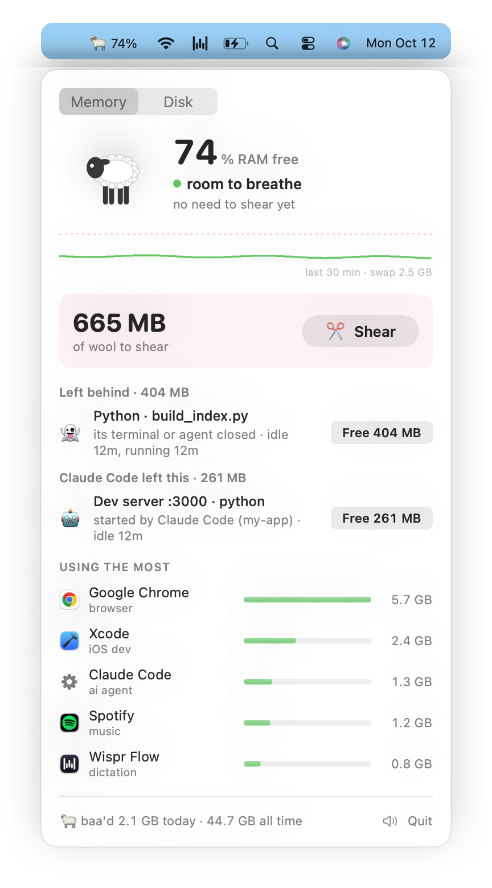

# baa 🐏

*a tiny ram for your RAM*


tldr; baa lives in your menu bar, tells you when your mac is about to run out of RAM or disk, finds the stuff quietly eating it, and frees it in one click.

## why

i built this because my mac keeps running out of RAM every 2 hours and i typically get around it by closing random apps and hoping it will help (it usually doesn't).

baa 🐏 is a little ram that headbutts all of that out of your mac.

## what it does

- lives in your menu bar as 🐏 + how much RAM is free. turns 🟡 / 🟠 / 🔴 when things are getting tight
- finds stuff you forgot was still running:
  - 👻 apps and scripts that should've closed but didn't
  - 🤖 things ai agents started and forgot about
  - 💤 big stuff just sitting there idle (agent sessions idle for hours, docker with no containers, an ollama model still loaded)
- tells you how much RAM you'd get back, and frees it in one click
- pings you a few minutes before you run out
- also finds dev junk filling up your disk (old builds, package caches etc.) and trashes it in one click
- plays a tiny baa when it frees something 🐑 (you can mute it but it's the best part imo)

<picture>
  <source media="(prefers-color-scheme: dark)" srcset="docs/menu-dark.png">
  
</picture>

## install

```sh
brew install selviarora/tap/baa
brew services start baa
```

that builds baa on your mac, starts it in your menu bar (and at every login), and adds the `baa` command. needs macOS 14+.

<details>
<summary>or build it yourself</summary>

you'll need xcode command line tools (`xcode-select --install`).

```sh
git clone https://github.com/selviarora/baa && cd baa
./install.sh
```

that builds the app into `~/Applications`, starts it when you log in, and adds the `baa` command.
</details>

## commands

| | |
|---|---|
| `baa` | RAM readout + leftovers, right in your terminal |
| `baa free <id>` | free one leftover (ids are in the readout) |
| `baa free all` | free everything it found |
| `baa disk` | dev junk taking up your disk |
| `baa disk clean <id>` | clear one (or `all`) |
| `baa test` | send a sample notification |

## how it decides what's a leftover

basically baa looks for stuff that's still running but not doing anything:

- its app or terminal is closed but it's still going
- an ai agent started it and it's been sitting idle for 15+ min
- it's big and hasn't used any cpu in a while

it also watches memory pressure (the green / yellow / red graph in activity monitor), not just how much RAM is used. macs use most of their RAM all the time and that's usually ok!

it will also never kill anything on its own.

## uninstall

if you used brew:

```sh
brew services stop baa && brew uninstall baa
```

if you built it yourself:

```sh
launchctl bootout gui/$(id -u)/com.selvi.baa
rm -rf ~/Applications/Baa.app ~/Library/LaunchAgents/com.selvi.baa.plist ~/.local/bin/baa
```

vibecoded this in 30 mins so hopefully nothing is broken!
