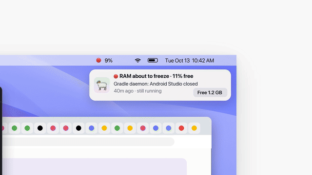

# baa 🐏

*a tiny ram for your RAM*

> **baatrees** is a fork of [selviarora/baa](https://github.com/selviarora/baa) that also finds stale git worktrees eating your disk and removes the safe ones (`baa trees`, or the Disk tab). everything else is selvi's baa, all credit to her 🐏



tldr; baa lives in your menu bar, tells you when your mac is about to run out of RAM or disk, finds the stuff quietly eating it, and frees it in one click.



if you like **baa**, i’d love a star ⭐️😄

## why

turns out most of my RAM wasn't going to apps i had open. it was mostly dev servers, builds and agent leftovers i'd forgotten about.

**baa** 🐏 is a little ram that headbutts all of that out of your mac. it plays a tiny baa when it frees something (you can mute this if you hate whimsy though :P)

## what it does

- lives in your menu bar as 🐏 + how much RAM is free. turns 🟡 / 🟠 / 🔴 when things are getting tight
- finds stuff you forgot was still running:
  - 👻 apps and scripts that should've closed but didn't
  - 🤖 things ai agents started and forgot about
  - 💤 big stuff just sitting there idle (agent sessions idle for hours, docker with no containers, an ollama model still loaded)
- tells you how much RAM you'd get back, and frees it in one click
- pings you a few minutes before you run out
- also finds dev junk filling up your disk (old builds, package caches etc.) and trashes it in one click
- 🌳 and git worktrees you stopped using (14+ days untouched). only offers to remove ones with nothing to lose: no uncommitted work, no commits that live only in that tree, nothing running in it. the branch always stays
- 🗺️ a disk map: a treemap of everything in your home folder, colored by when it last changed. big and blue = space nobody's touching. reads every file, so the first scan takes a minute or two. hit ⤢ to open it in a big window where folders open up inside each other


## install

```sh
brew tap jeffrayzhang/baatrees https://github.com/JeffrayZhang/baatrees
brew trust jeffrayzhang/baatrees      # homebrew 7+ won't load a third-party tap until you trust it
brew install jeffrayzhang/baatrees/baa
brew services start jeffrayzhang/baatrees/baa
```

that builds baa on your mac, starts it in your menu bar (and at every login), and adds the `baa` command. needs macOS 14+.

already have the original baa from brew? both are called `baa`, so swap it out first:

```sh
brew services stop baa && brew uninstall baa && brew untap selviarora/baa
```

<details>
<summary>or build it yourself</summary>

you'll need xcode command line tools (`xcode-select --install`).

heads up: on a work mac running santa in lockdown mode, apps in `~/Applications` can get killed on launch (`zsh: killed baa`). brew installs into `/opt/homebrew`, which is usually allowed, so use brew there. check with `santactl fileinfo ~/Applications/Baa.app/Contents/MacOS/Baa`.

```sh
git clone https://github.com/JeffrayZhang/baatrees && cd baatrees
./install.sh
```

that builds the app into `~/Applications`, starts it when you log in, and adds the `baa` command.
</details>

## commands

| | |
|---|---|
| `baa` | RAM readout + leftovers, right in your terminal |
| `baa free <id>` | free one leftover (ids are in the readout) |
| `baa free all` | free everything it found |
| `baa disk` | dev junk taking up your disk |
| `baa disk clean <id>` | clear one (or `all`) |
| `baa trees` | old git worktrees, and what's keeping the rest around |
| `baa trees clean <id>` | remove one (or `all` the safe ones) |
| `baa trees days 30` | count a tree as old after 30 days untouched (default 14) |
| `baa map` | treemap of your home folder: box size = space, color = when it last changed (also the Map tab) |
| `baa map ~/world` | look inside one folder. instant after the first scan; `--rescan` for fresh numbers |
| `baa map --window` | the map in a big resizable window: folders open up inside each other, plus a list of everything (or hit ⤢ on the Map tab) |
| `baa warn 20 10` | go 🟡 at 20% free and 🔴 at 10% (or tap the sliders icon in the panel) |
| `baa test` | send a sample notification |

## warning levels

by default baa goes 🟡 at 15% RAM free and 🔴 at 8%. to change that, click 🐏 → the sliders icon at the bottom → set your own. or from the terminal:

```sh
baa warn 20 10   # 🟡 at 20% free, 🔴 at 10%
baa warn         # see what it's set to
```

it'll still go 🔴 if macOS itself says memory is critical.

the 🟠 "dropping fast" heads-up only fires when RAM keeps sliding and you're close to 🟡, not on every app launch. turn it off in the same place, or with `baa warn --no-trend`.

## how it decides what's a leftover

basically baa looks for stuff that's still running but not doing anything:

- its app or terminal is closed but it's still going
- an ai agent started it and it's been sitting idle for 15+ min
- it's big and hasn't used any cpu in a while

it also watches memory pressure (the green / yellow / red graph in activity monitor), not just how much RAM is used. macs use most of their RAM all the time and that's usually ok!

it will also never kill anything on its own.

## update

```sh
brew upgrade jeffrayzhang/baatrees/baa
```

or if you built it yourself: `git pull && ./install.sh`

## uninstall

if you used brew:

```sh
brew services stop baa && brew uninstall baa && brew untap jeffrayzhang/baatrees
```

if you built it yourself:

```sh
launchctl bootout gui/$(id -u)/com.selvi.baa
rm -rf ~/Applications/Baa.app ~/Library/LaunchAgents/com.selvi.baa.plist ~/.local/bin/baa
```

vibecoded this in 30 mins so hopefully nothing is broken!
